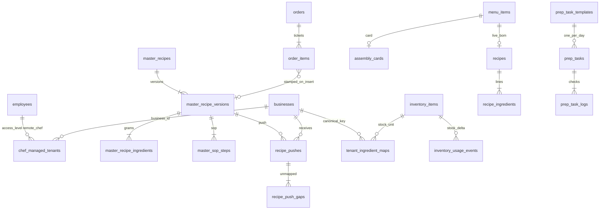

# Remote Chef architecture

Chef-as-a-Service on top of the current icaffeOS stack: React + Vite in `frontend_source/`, Dexie (`KDSDatabase`) in `frontend_source/src/db/database.js`, Supabase PostgreSQL in `supabase/migrations/`, KDS in `frontend_source/src/pages/kds/`.

The executable schema, RLS, push, prep, and telemetry live in:

`supabase/migrations/20261117120000_remote_chef_architecture.sql`

TypeScript contracts live in `frontend_source/src/types/remoteChef.ts`.

This migration does not change KDS screens or Dexie yet. Those steps are specified below and come after the SQL is applied.

## What the current system actually is

| Brief name | Existing name | Where |
| --- | --- | --- |
| tenant | `businesses.id`, column `business_id` | `00000000000000_schema.sql` |
| user role | `employees.access_level` text (`Worker`, `Manager`, `Admin`) plus `is_admin`, `is_super_admin` | same file; `invite_staff_final` |
| auth link | `employees.auth_user_id = auth.uid()` | `current_user_business_id()` |
| menu | `menu_items.id integer`, `business_id` | schema |
| BOM | `recipes` + `recipe_ingredients` | schema; deducted by `deduct_inventory_for_order` |
| prep chores | `recurring_tasks` + `task_completions` | schema; already in Dexie v19 and `SYNC_CONFIG` |
| invoice price | `supplier_order_items.unit_price` | schema |
| stock floor | `inventory_items.low_stock_alert`, `cost_per_unit` | schema |
| KDS clock | `order_items.item_fired_at`, `updated_at`, `orders.ready_at` | schema; `OrderCard` `PrepTimer` |
| offline mirror | Dexie `KDSDatabase` version **27** | `frontend_source/src/db/database.js` |
| downlink | `syncTable` in `frontend_source/src/services/syncService.js` | `bulkPut`, no wipe |
| uplink | `offline_queue_v3` | `frontend_source/src/services/offlineQueue.js` |

`tenant_id` is not a column. `chef_managed_tenants.business_id` is the tenant key.

### RLS is not isolating tenants today

`supabase/migrations/20260409000002_fix_superadmin_rpc_and_rls.sql` disables RLS on `businesses`, `employees`, `menu_items`, `orders`, `order_items`, and `item_category`. Kiosk login is a PIN stored in `localStorage` (`FullAuthContext.jsx`). The Supabase client in `frontend_source/src/lib/supabase.js` uses the anon key. `syncService.js` filters with `business_id` in the query. It does not rely on `auth.uid()`.

`current_user_business_id()` returns a hardcoded pilot UUID when the employee row has no business. Authorization in this design does not call that function.

`business_assets` policies compare `employees.id` to `auth.uid()`. The working link elsewhere is `employees.auth_user_id`. New policies use `auth_user_id`.

### Historical orders must stay put

`deduct_inventory_for_order` subtracts `recipe_ingredients.quantity_used * order_items.quantity` from `inventory_items.current_stock` for the current recipe of `menu_item_id`. `order_items` already stores `menu_item_id`, `quantity`, and `price`. A push may update the live `recipes` row and its child lines. It must not `UPDATE` or `DELETE` `orders` or `order_items`.

`99999999_all_functions_sync.sql` sorts after this migration and redefines `deduct_inventory_for_order`. The usage ledger is an `AFTER UPDATE OF current_stock` trigger so that redefinition does not drop it.

`recipes` and `recipe_ingredients` are not in Dexie. `prepbatches.recipe_id` is uuid while `recipes.id` is integer, so prep batches are not reused.

### Local inventory UI that is not in git

`main` matches `origin/main` at `53a20d8e`. Nothing is waiting to be pushed. The iPad inventory work is only in the working tree, last edited 21 Sep 2026:

- 10 modified files under `frontend_source/src/pages/ipad_inventory/` (`+1265 / −895`)
- untracked `frontend_source/src/pages/ipad_inventory/components/SupplierOrderModal.tsx`

That UI reads `inventory_items.target_stock` and builds packaging levels (sleeve/carton for cups and lids, 100 g steps for coffee). `target_stock` is not a column in `00000000000000_schema.sql`. Telemetry and reorder math in this migration use `low_stock_alert` and `case_quantity` only. Do not point the chef RPC at `target_stock` until that column is migrated and the inventory diff is committed on its own.

## Module 1 — chef hierarchy

A remote chef is one `employees` row:

- `access_level = 'remote_chef'`
- `auth_user_id` set
- `business_id` is their home row only, not the list of clients

Client access is only `chef_managed_tenants`:

| Column | Meaning |
| --- | --- |
| `chef_employee_id` | the `remote_chef` employee |
| `business_id` | one client business |
| `can_edit_menu` | direct updates to that tenant's `menu_items` |
| `can_push_recipes` | `push_master_recipe_to_tenant` and prep templates |
| `can_view_financials` | invoice prices and food-cost % |
| `revoked_at` | set to revoke; the unique key stays so the same pair can be reactivated |

All three flags false is an observer: operational read (cards, prep, ticket time, stock quantity) and no menu write, no push, no money.

Grants are inserted by a manager of that business (`is_admin` or `access_level` in `Manager` / `Admin`) or a super admin. A chef cannot insert their own grant. A trigger rejects a `chef_employee_id` whose `access_level` is not `remote_chef`.

Helpers, all `SECURITY DEFINER`, `search_path = public`, granted to `authenticated` only:

- `current_employee_id()`
- `is_super_admin()`
- `staff_is_member(business)`
- `staff_can_admin_business(business)`
- `user_can_access_business(business)` — super admin, home staff, or an active grant
- `chef_can(business, permission)`
- `can_read_master_recipe(recipe)`
- `can_write_master_recipe(recipe)` — author or an admin of `owner_business_id`, not every remote chef

RLS is enabled on every new table. On the old POS tables the migration only **adds** permissive policies. It does not `ENABLE ROW LEVEL SECURITY` on `orders`, `menu_items`, or `inventory_items`, because the kiosk anon client would go empty.

| Who | Sees `business_id` | Menu write | Push | Food cost / invoice price |
| --- | --- | --- | --- | --- |
| Staff of that business | yes | manager / admin | manager / admin | yes |
| Remote chef, active grant | yes | only `can_edit_menu` | only `can_push_recipes` | only `can_view_financials` |
| Remote chef, revoked or no row | no | no | no | no |
| Other businesses' staff | no | no | no | no |
| Super admin | yes | yes | yes | yes |

`get_chef_command_center_telemetry` is `SECURITY DEFINER` and repeats those checks in the function body. A permissive policy is not enough, because the function owner bypasses RLS. The RPC is granted to `authenticated` and `service_role`, not `anon`.

## Module 2 — master library and push



Library tables use uuid keys so they do not share the integer sequences of `menu_items` and `recipes`.

- `master_recipes` — identity. `owner_business_id` null means the global library. Archived recipes cannot be pushed.
- `master_recipe_versions` — immutable publication unit. Status `draft | published | retired`. Only `published` can be pushed. Weights are grams. `yield_percent` is usable yield. `allergen_tags` is `text[]`. `plating_media_url` and `target_prep_seconds` feed the KDS card.
- `master_recipe_ingredients` — `quantity_grams`, per-line `yield_percent`, `canonical_key`, `is_optional`.
- `master_sop_steps` — `phase` is `prep` or `assembly`, unique on `(version_id, phase, step_order)`.

`tenant_ingredient_maps` is the only place a canonical key becomes a tenant `inventory_items.id`. `grams_per_stock_unit` is how many grams one `current_stock` unit is. If it is null, push uses `inventory_items.weight_per_unit`, then the unit name (`גרם`/`g` = 1, `ק"ג`/`kg` = 1000). Millilitres are not guessed as grams. An unmapped line becomes a gap.

`push_master_recipe_to_tenant(version_id, business_id)`:

1. Caller is service role, or has `can_push_recipes`, or is a manager of that business.
2. Reuse the tenant `menu_items` row with the same `(business_id, master_recipe_id)`. Otherwise insert one new row. Price, photo, and `kds_routing_logic` are set only on insert. A later push does not overwrite the tenant's price or routing.
3. Reuse the latest `recipes` row for that `menu_item_id`. Otherwise insert one. The integer `menu_item_id` on past `order_items` does not change.
4. Convert each ingredient: `raw_grams = quantity_grams / (yield_percent / 100)`, `quantity_used = raw_grams / grams_per_stock_unit`.
5. If every required ingredient mapped: delete that recipe's `recipe_ingredients` and insert the new lines. Status `applied`. Set `menu_items.master_version_id`.
6. If any required ingredient did not map: status `partial`. Update or insert the mapped lines only. Do not delete the existing BOM. Do not move `master_version_id`, so new tickets keep the last good stamp.
7. Always refresh `assembly_cards` for that `menu_item_id`. `card.complete` is true only when status is `applied`.
8. Write `recipe_pushes` and `recipe_push_gaps`.

`order_items.recipe_version_id` is filled by a `BEFORE INSERT` trigger from `menu_items.master_version_id`. Old tickets stay null. Push never backfills them.

## Module 3 — guided assembly and daily prep

KDS staff read `assembly_cards`, not the master tables. One card per `menu_item_id`, payload in `card jsonb` (shape: `AssemblyCardPayload`).

`recurring_tasks` stays the opening/closing checklist. Chef prep is separate:

- `prep_task_templates` — standing morning batches, optional `days_of_week` (`0` Sunday … `6` Saturday)
- `prep_tasks` — one row per template per `service_date` (partial unique index)
- `prep_task_logs` — append-only. Unique `(prep_task_id, client_mutation_id)` makes a retry safe

`generate_daily_prep_tasks(business_id, service_date)` inserts missing rows. Authenticated managers and chefs with `can_push_recipes` only.

`complete_prep_task(...)` inserts the log and sets the task `done`. The same `client_mutation_id` returns the existing log and does not write a second one.

### KDS component tree

Existing files stay the ticket engine. New files are the card and the checklist.

```text
frontend_source/src/pages/kds/
  index.jsx                          existing board
  components/OrderCard.jsx           add onOpenAssembly(menuItemId); do not reuse the status buttons
  components/VisualAssemblyCard.jsx  new overlay
  components/DailyPrepList.jsx       new checklist
  hooks/useKDSDataLocal.js           unchanged order path
  hooks/useAssemblyCard.js           useLiveQuery on assembly_cards by menu_item_id
  hooks/usePrepTasks.js              today's prep_tasks + local logs

frontend_source/src/pages/chef/
  ChefCommandCenter.tsx              calls get_chef_command_center_telemetry
  hooks/useChefTelemetry.ts

frontend_source/src/types/remoteChef.ts
```

`VisualAssemblyCard` is a full-screen high-contrast sheet for a line cook who is not a chef:

- recipe name, step `n / N`, phase (`הכנה` / `הרכבה`)
- gram weight in the largest type on the step
- one plating image (`plating_media_url`), cached through the existing `cached_images` store
- target seconds from `target_prep_seconds`
- allergen tags as text, not color alone
- if `card.complete` is false, a banner that the BOM is partial and which canonical names are unmapped

`OrderCard` is marked do-not-restyle. The only addition is an item tap that opens the card. Status, payment, and SMS handlers stay as they are.

`DailyPrepList` lists `prep_tasks` for the service date (KDS day starts 05:00, same cutoff as `useKDSDataLocal`). Checking a row writes the local log immediately and enqueues the RPC. The checkbox state comes from the local log, so a dropped network does not uncheck it.

## Module 4 — telemetry

`get_chef_command_center_telemetry(p_from, p_to, p_business_id default null)` returns one jsonb document (`ChefCommandCenterTelemetry`).

Scope:

- a passed `business_id` must pass `user_can_access_business`
- null and super admin: every business
- null otherwise: the employee's home `business_id` plus active grants
- anon is rejected

Per business:

| Block | Rule |
| --- | --- |
| `food_cost` | Latest `supplier_order_items.unit_price` for that business (`DISTINCT ON inventory_item_id` by `received_date`), else `inventory_items.cost_per_unit`, times `recipe_ingredients.quantity_used`, divided by `menu_items.price`. Null for a chef without `can_view_financials`. Staff of the business still see their own. |
| `variance` | Theoretical qty is ticket qty times the **current** BOM (the latest recipe for that menu item). Actual qty is `inventory_usage_events` of type `consumption` in the window. `unexplained_qty = actual - theoretical`. |
| `ledger_active` | False when the window has no usage events. `actual_qty` is then null rather than a fake zero. |
| `kds` | Average of `updated_at - coalesce(item_fired_at, created_at)` for items that have a card and are no longer `new` or `cancelled`. `breach` when the sample is at least 5 and the average is over the average `target_prep_seconds`. |
| `stock_alerts` | `current_stock <= low_stock_alert`. Suggested qty rounds up to `case_quantity` when that is greater than 1. This is a suggestion, not an inserted `supplier_orders` row. |
| `prep` | Counts for `CURRENT_DATE` plus the sum of `actual_yield_grams` logged today. |

`unexplained_qty` is not a waste verdict. The trigger logs every stock decrease: sales, a count-down, spoilage, and morning prep that consumed raw stock. Ticket BOM does not include prep output. A positive number means more left the shelf than tickets explain. The prep log is how the chef accounts for part of it. Units of finished yield and raw stock are not auto-netted.

The ledger starts at migration time. Older tickets have no `recipe_version_id` and no usage events. Variance before the trigger is not reconstructed.

## Module 5 — Dexie

Next store version is **28**. Copy every store line from version 27 and add:

```text
assembly_cards: 'id, business_id, menu_item_id, master_version_id, updated_at'
prep_task_templates: 'id, business_id, is_active, menu_item_id'
prep_tasks: 'id, business_id, service_date, status, menu_item_id, template_id, [business_id+service_date]'
prep_task_logs: 'id, prep_task_id, business_id, client_mutation_id, checked_at, pending_sync'
```

Do not drop `offline_queue_v3`. Version 27 is the last declared schema; skipping a version is already how this file jumped to 27.

Downlink, same reconciliation as the rest of `syncTable` (`bulkPut`, never `clear()` before pull):

| Local store | Remote read |
| --- | --- |
| `assembly_cards` | `get_assembly_cards_for_sync(p_business_id)` |
| `prep_tasks` | `get_prep_tasks_for_sync(p_business_id, service_date)` |
| `prep_task_templates` | table select for authenticated chef/manager only |

Those two RPCs are granted to `anon` because the kiosk has no user JWT, matching `get_customers_for_sync`. If `auth.uid()` is present, the RPC still requires `user_can_access_business`. A logged-in user who is not on that tenant is rejected. An anon caller who knows a business UUID can pull cards, which is the same exposure customer sync already has. Do not widen it to supplier prices.

Uplink for a check-off:

1. Write `prep_task_logs` in Dexie with `pending_sync = true` and a new `client_mutation_id`.
2. Enqueue `offline_queue_v3` action `COMPLETE_PREP_TASK`.
3. The queue calls `complete_prep_task`. Conflict on `client_mutation_id` is a success.
4. Assembly cards are read-only on the tablet. Server `updated_at` wins. A partial card still replaces the previous payload so the steps on screen match the last push.

Plating URLs go through `cached_images` (`url, cached_at`) inside `imageSyncService` when a card is pulled. The card renders with no image if that fetch has not finished; the gram steps still render.

`subscribeToAllChanges` should add `assembly_cards`, `prep_tasks`, and `prep_task_logs` for the open `business_id`. Loss of realtime is not a stall: the next `syncTable` pull repairs the mirror. Order status keeps the existing shadow path in `kds.md`. Prep check-off is the exception that writes Dexie first, because the kitchen has to record a batch with no network.

Master tables are not mirrored onto the KDS tablet.

## Rollout

1. Apply `20261117120000_remote_chef_architecture.sql` on a database that already has `businesses`, `employees`, `menu_items`, `recipes`, `recipe_ingredients`, `inventory_items`, `orders`, `order_items`, `supplier_orders`, and `supplier_order_items`.
2. Create the chef employee with `access_level = 'remote_chef'` and `auth_user_id`, then insert `chef_managed_tenants` as the client manager.
3. Publish a master version, fill `tenant_ingredient_maps`, call `push_master_recipe_to_tenant`.
4. Ship Dexie 28 and the two sync RPCs before any tablet depends on cards.
5. Add `VisualAssemblyCard` and `DailyPrepList`.
6. Add the chef command center.
7. Re-enable RLS on `orders` / `menu_items` only after kiosk sessions are real JWTs. Doing it in this migration would blank the current anon tablets. The permissive policies added here are the chef's access for that later day.

Do not fold the uncommitted iPad inventory diff into the chef migration. It is a separate packaging and `target_stock` change and it is not on `origin/main`.
